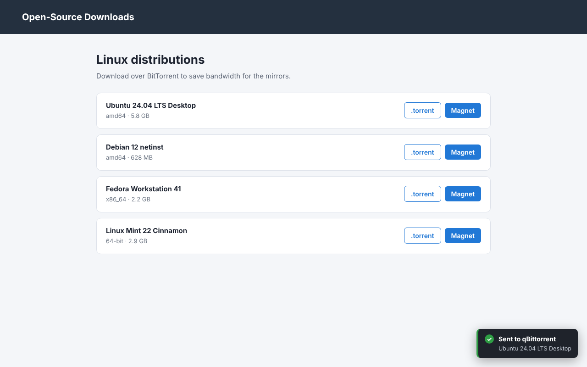
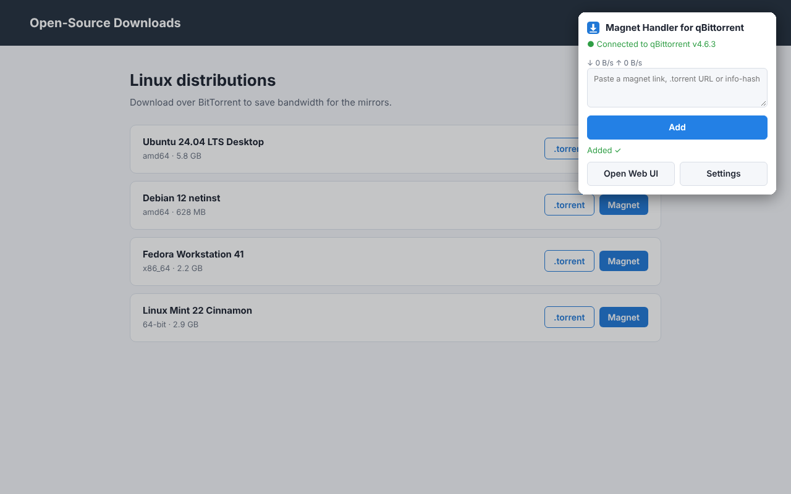

# Magnet Handler for qBittorrent

A browser extension that sends magnet links and `.torrent` files straight to your qBittorrent, with one click or from the right-click menu.

Works in **Chrome, Brave, Edge, Vivaldi** and other Chromium-based browsers, on Windows, macOS and Linux.

## Features

- **Click a magnet link** and it goes straight to qBittorrent, with a small "Sent to qBittorrent" message in the corner of the page. If something goes wrong, the message tells you why.
- **Right-click any magnet or `.torrent` link** and choose:
  - Send to qBittorrent
  - Send to qBittorrent (paused)
  - Send to one of your qBittorrent categories
- **Select a magnet link or info-hash in text**, right-click and send it.
- **Toolbar button**: paste a link, check the connection, see download and upload speeds, or open your Web UI.
- **`.torrent` files are downloaded by your browser first**, so links on sites where you need to be logged in still work.
- **Default options** you can set: save folder, category, add paused, sequential download, first and last pieces first.
- Works with qBittorrent **4.x and 5.x**, on the same computer or anywhere on your network (home server, NAS, seedbox, reverse proxy).
- Works with qBittorrent's built-in security protection switched on. You don't need to turn anything off.
- Light and dark mode.

## Installing

1. **Download** this project: click the green **Code** button at the top of this page, then **Download ZIP**.
2. **Unzip it** somewhere you'll keep it, like your Documents folder. Don't delete the folder afterwards, because the browser loads the extension from it.
3. Open your browser's extensions page by typing this in the address bar:
   - Chrome / Vivaldi: `chrome://extensions`
   - Brave: `brave://extensions`
   - Edge: `edge://extensions`
4. Turn on **Developer mode** (a switch, usually in the top-right corner).
5. Click **Load unpacked** and select the unzipped folder. Choose the folder that contains `manifest.json`.
6. The settings page opens automatically. Continue with the setup below.

> Tip: click the puzzle-piece icon in the toolbar and pin **Magnet Handler** so its button is always visible.

## Setup

### 1. Turn on qBittorrent's Web UI

In qBittorrent open **Tools → Options → Web UI** (on Mac: **qBittorrent → Settings → Web UI**):

1. Tick **Web User Interface (Remote control)**.
2. Note the **Port** (default `8080`).
3. Set a **username and password**.
4. Click **Apply** / **OK**.

### 2. Connect the extension

In the extension's settings page:

1. **Web UI address**:
   - qBittorrent on the same computer: `http://localhost:8080`
   - Another computer on your network: e.g. `http://192.168.1.50:8080`
2. Enter the same **username and password** you set in qBittorrent.
3. Click **Save** and allow the permission Chrome asks for.

You should see **"Connected — qBittorrent vX.Y"**. That's it.

## Updating

1. Download the new version and unzip it **over the old folder**, replacing the files.
2. Go to your browser's extensions page and click the reload ↻ icon on Magnet Handler.

Your settings are kept.

## Troubleshooting

| Message | Fix |
|---|---|
| *Can't reach qBittorrent* | Make sure qBittorrent is running, the Web UI is turned on, and the address and port are right. |
| *Login failed* | Check the username and password match what's in qBittorrent's Web UI settings. |
| *Temporarily banned* | Too many wrong passwords. Wait a while, or restart qBittorrent. |
| *Didn't accept it* | The torrent is probably already in your list, or the link is broken. |
| Magnet clicks still open the desktop app | Make sure **"Send magnet links to qBittorrent when I click them"** is ticked in settings, then reload the web page. |

## About the permissions

When you click Save, the browser asks for permission to access websites. This is used to:

- reach your qBittorrent, which can be at any address you choose;
- catch clicks on magnet links on the site you're on;
- download `.torrent` files with your browser's login;
- show the confirmation message on the page.

If you untick **"Send magnet links… when I click them"** and **"Download .torrent files with the browser first"**, the extension only asks for access to your qBittorrent address.

## Privacy

Your settings, including your qBittorrent password, are stored in your browser on your own computer. They are only ever sent to your own qBittorrent. There are no analytics, no tracking and no outside servers. See the [privacy policy](docs/privacy-policy.html).

## Disclaimer

This is an independent project and is not affiliated with or endorsed by the qBittorrent project. Please respect copyright law in your country and only download content you have the right to.

## License

[MIT](LICENSE)
